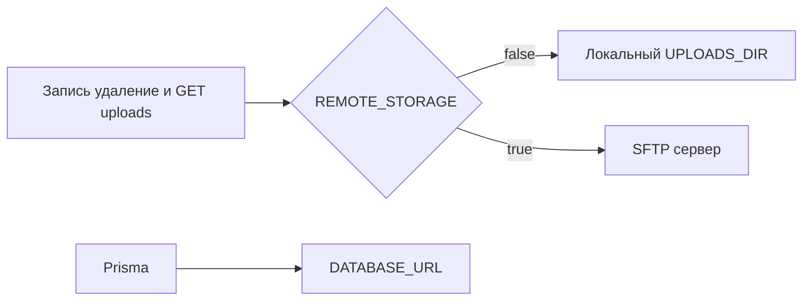

# Удалённые файлы через SFTP

База уже подключена в `[src/prisma/prisma.service.ts](src/prisma/prisma.service.ts)` по `DATABASE_URL`. Отдельный код для неё не нужен: в локальном `.env` строка указывает на корпоративный Postgres. Файлы сейчас пишутся только на диск и отдаются с локальной папки.

Точки записи и удаления:

- `[src/modules/projects/project-storage.service.ts](src/modules/projects/project-storage.service.ts)` — превью проекта
- `[src/modules/versions/version-storage.service.ts](src/modules/versions/version-storage.service.ts)` — файлы версий
- `[src/main.ts](src/main.ts)` — `@fastify/static` с префиксом `/uploads/`

`prisma/seed.ts` остаётся на локальном диске, чтобы сид не затирал каталоги на корпоративном сервере.

## Настройка `.env`

В `[.env.example](.env.example)`, `[src/config/configuration.ts](src/config/configuration.ts)` и `[src/config/env.validation.ts](src/config/env.validation.ts)`:

- `REMOTE_STORAGE=false` — по умолчанию локальный диск, как сейчас
- при `true` обязательны `SFTP_HOST`, `SFTP_USERNAME`, `SFTP_UPLOADS_DIR` и один из способов входа: `SFTP_PASSWORD` или `SFTP_PRIVATE_KEY` (путь к ключу)
- `SFTP_PORT` необязателен, по умолчанию `22`
- `SFTP_UPLOADS_DIR` — абсолютный каталог на сервере, например `/var/app/uploads`
- `DATABASE_URL` при удалённом режиме указывает на Postgres этого сервера; код Prisma не меняется

Локальный `UPLOADS_DIR` при `REMOTE_STORAGE=true` не используется.

## Хранилище

Зависимость: `ssh2-sftp-client` и типы `@types/ssh2-sftp-client`.

Один сервис, например `[src/modules/uploads/uploads-storage.service.ts](src/modules/uploads/uploads-storage.service.ts)`:

- `write(relativePath, buffer)`, `delete(relativePath)`, `read(relativePath)`
- при `false` — текущие `mkdir` / `writeFile` / `unlink` / чтение с диска
- при `true` — одно SFTP-соединение в `onModuleInit`, закрытие в `onModuleDestroy`; операции в очереди, потому что клиент не держит параллельные команды
- удалённые пути через `path.posix` от `SFTP_UPLOADS_DIR`; сегменты `..` отклоняются
- каталоги на сервере создаются рекурсивно перед записью (`projects/{id}`, `frames/{id}/versions`)

Оба storage-сервиса оставляют свою логику имён и расширений и вызывают общий сервис. `savePreview`, `saveVersionFile` и `deleteFile` становятся `async`; вызовы в `[projects.service.ts](src/modules/projects/projects.service.ts)` и `[versions.service.ts](src/modules/versions/versions.service.ts)` получают `await`.

## Отдача файлов

В `[src/main.ts](src/main.ts)`:

- `REMOTE_STORAGE=false` — как сейчас: создать локальный каталог и зарегистрировать `@fastify/static` на `/uploads/`
- `REMOTE_STORAGE=true` — static для uploads не регистрировать; маршрут `GET /uploads/*` читает файл через storage и отдаёт его с `Content-Type` по расширению. Нет файла — 404

SPA и `public/` не затрагиваются.

## Документация

В `[README.md](README.md)` кратко описать флаг, SFTP-переменные и то, что `DATABASE_URL` при удалённом режиме должен указывать на корпоративный Postgres.